# 🖥️ PumpVision — ENV-COOL-FIRE

### Hệ thống SCADA/HMI giám sát môi trường & điều khiển làm mát – dập lửa khẩn cấp cho phòng máy chủ

**ESP32 là "bộ não" của hệ thống** · Modbus RTU RS-485 · Web ERP có mô hình 3D Digital Twin · chạy được trong hạn mức Firebase free tier

<p align="center">
<a href="tests/"></a>
<a href="https://www.python.org/"></a>
<a href="https://micropython.org/"></a>
<a href="https://firebase.google.com/"></a>


</p>

<p align="center">
<a href="https://www.espressif.com/"></a>
<a href="https://modbus.org/"></a>
<a href="https://modbus.org/"></a>
</p>

<p align="center">
  <b>🌐 Demo trực tuyến:</b> <a href="https://venhladamz-star.github.io/-ktm/">https://venhladamz-star.github.io/-ktm/</a>
  <br><em>Web ERP chạy thật trên GitHub Pages — mở trực tiếp, không cần cài đặt</em>
</p>

<p align="center">
  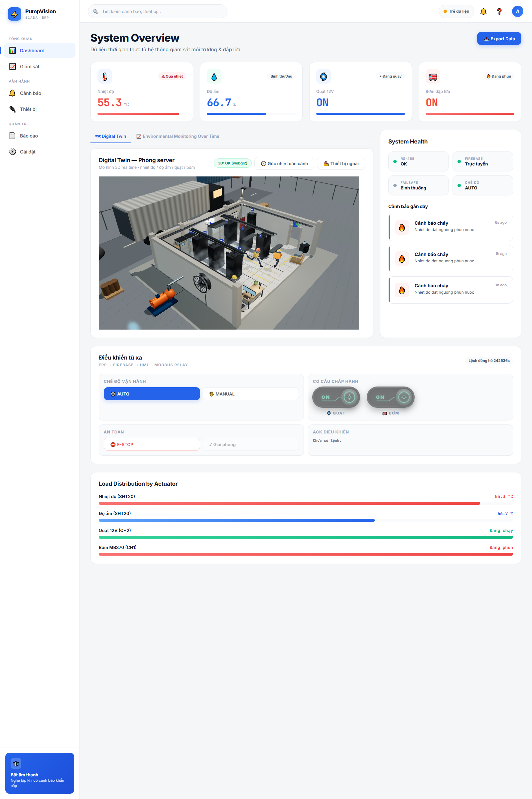
  <br>
  <em>Web ERP — System Overview: mô hình 3D Digital Twin của phòng máy cập nhật realtime cùng KPI nhiệt độ – độ ẩm và trạng thái tải</em>
</p>

---

## 📑 Mục lục

| # | Nội dung | # | Nội dung |
|---|---|---|---|
| 1 | [Vấn đề & giải pháp](#-vấn-đề--giải-pháp) | 8 | [Giao diện người dùng](#-giao-diện-người-dùng) |
| 2 | [Tính năng](#-tính-năng) | 9 | [Logic điều khiển & an toàn](#-logic-điều-khiển--an-toàn) |
| 3 | [Kiến trúc hệ thống](#-kiến-trúc-hệ-thống) | 10 | [Kiểm chứng](#-kiểm-chứng) |
| 4 | [Phần cứng](#-phần-cứng) | 11 | [Chạy thử nhanh](#-chạy-thử-nhanh) |
| 5 | [Mô hình thực tế](#-mô-hình-thực-tế) | 12 | [Cấu trúc thư mục](#-cấu-trúc-thư-mục) |
| 6 | [Linh kiện](#-linh-kiện) | 13 | [Bảo mật & giới hạn](#-bảo-mật--giới-hạn) |
| 7 | [Giao thức truyền thông](#-giao-thức-truyền-thông) | 14 | [Tài liệu](#-tài-liệu) |

---

## 🎯 Vấn đề & giải pháp

Phòng máy chủ tích tụ nhiệt liên tục. Khi hệ thống làm mát hoặc bơm dập lửa gặp sự cố, một lỗi nhỏ có thể thành hỏa hoạn. Hệ thống giám sát phổ biến hoặc **chỉ đo** (không điều khiển), hoặc đặt toàn bộ logic ở máy tính trung tâm — nên **mất mạng hoặc mất laptop là mất luôn lớp bảo vệ**.

**PumpVision đảo ngược triết lý đó:**

> 🔒 **ESP32 quyết định trạng thái. ERP chỉ quyết định ý định. HMI là cầu nối.**

Toàn bộ logic an toàn (hysteresis, failsafe, E-STOP, chống chạy lệnh) **chạy ngay trên vi điều khiển** ⇒ mất laptop, mất Firebase, mất mạng thì thiết bị vẫn tự điều khiển và tự bảo vệ.

| | Thiết kế phổ biến | PumpVision |
|---|---|---|
| Logic điều khiển | Trên máy tính / cloud | **Trên ESP32** (MicroPython) |
| Mất mạng | Mất luôn điều khiển | **Vẫn chạy tự động** |
| Giao diện | Console / dashboard | SCADA/HMI desktop **+ Web ERP + mô hình 3D** |
| Trạng thái tải | Gửi kèm theo lệnh | **Chỉ gửi ý định**, board tự xác nhận |

---

## ✨ Tính năng

<table>
<tr>
<td width="50%" valign="top">

<b>🎛 Điều khiển &amp; an toàn</b>
<ul>
<li>Hysteresis chống dao động — quạt <code>32/30 °C</code>, bơm <code>50/42 °C</code></li>
<li><b>Failsafe</b>: mất cảm biến → ngắt bơm ngay (giữ quạt làm mát)</li>
<li><b>E-STOP</b> khóa cả hai tải, chỉ gỡ được khi board xác nhận an toàn</li>
<li>Chống chạy lệnh bằng <b>seq tăng dần</b> (lưu flash + seed từ telemetry)</li>
<li>Lệnh E-STOP <b>được miễn kiểm tra tuổi</b> ⇒ luôn tới được board</li>
</ul>

</td>
<td width="50%" valign="top">

<b>🖥 Phần mềm</b>
<ul>
<li><b>Web ERP</b> 6 màn hình, chạy nguyên bản — không framework, <b>không bước build</b></li>
<li><b>Mô hình 3D Digital Twin</b> phòng máy (React + three.js), cập nhật realtime</li>
<li>SCADA/HMI desktop với <b>sơ đồ công nghệ động</b> (synoptic mimic view)</li>
<li>Lịch sử, cảnh báo, xuất CSV/JSON, cấu hình 4 ngưỡng ngay trên web</li>
<li>Chống XSS (<code>escapeHTML</code>/<code>num</code>) và CSV injection</li>
<li><b>240 test hồi quy</b> chạy được ngay trên máy</li>
</ul>

</td>
</tr>
<tr>
<td width="50%" valign="top">

<b>🔌 Kết nối</b>
<ul>
<li>Modbus RTU <b>9600 8N1</b> trên bus RS-485 2 dây (ESP32 là master duy nhất)</li>
<li>Lớp Modbus <b>thuần Python</b> tự tính CRC16 — không phụ thuộc thư viện ngoài</li>
<li>JSON-lines trên USB-C ở <b>115200 baud</b></li>
<li>Firebase RTDB làm kênh trung chuyển duy nhất (REST API + JS SDK)</li>
</ul>

</td>
<td width="50%" valign="top">

<b>📈 Vận hành được bền vững</b>
<ul>
<li><b>Chế độ free tier</b>: HMI tự chọn nhịp ghi/đọc theo nhịp tim ERP (có ERP → nhịp nhanh; không ERP → nhịp tiết kiệm) ⇒ <b>không cần bật Blaze</b></li>
<li>24/7 chỉ ~3.500 ghi + ~19.000 đọc/ngày (18% / 38% hạn mức)</li>
<li>Thread nền tự khởi động lại nếu crash, có backoff khi mạng lỗi</li>
<li>Tự mở lại kết nối serial khi rút/cắm cáp</li>
</ul>

</td>
</tr>
</table>

---

## 🏗 Kiến trúc hệ thống

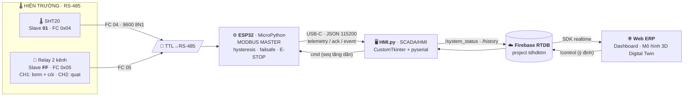

<p align="center">
  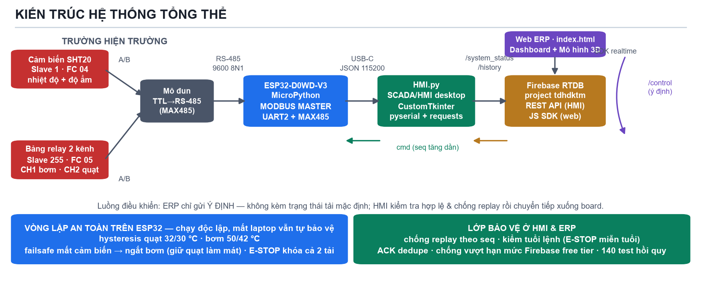
</p>

**Ba tầng, không máy chủ trung gian:**

1. **Tầng hiện trường** — ESP32-D0WD-V3 là Modbus master duy nhất: đọc SHT20, chạy logic, ghi relay. Mất laptop vẫn tự an toàn.
2. **Tầng trung gian** — `HMI.py` trên laptop: cầu nối serial ↔ Firebase, kiểm tra tuổi lệnh & chống replay, đồng bộ trạng thái.
3. **Tầng quản lý** — Firebase RTDB làm kênh duy nhất; Web ERP đọc/ghi theo thời gian thực.

---

## 🔌 Phần cứng

| # | Linh kiện | Vai trò |
|---|---|---|
| 1 | **ESP32-D0WD-V3** (ESP32-WROOM-32) | Vi điều khiển trung tâm · Modbus master · giữ toàn bộ logic điều khiển |
| 2 | **Mô đun chuyển đổi TTL → RS-485** (MAX485 / SP3485) | Nối UART2 của ESP32 với bus RS-485 2 dây A/B — *bắt buộc, ESP32 không có RS-485 sẵn* |
| 3 | **Cảm biến SHT20** (Modbus slave 1) | Đo nhiệt độ + độ ẩm (FC 04) |
| 4 | **Bảng relay 2 kênh** (Modbus slave 255) | CH1: máy bơm MB370 + còi báo · CH2: quạt 12 V (FC 05) |
| 5 | **Quạt làm mát 12 V DC** (0,28 A) | Tải CH2 — làm mát khi vượt ngưỡng |
| 6 | **Máy bơm MB370 5 V + còi báo** | Tải CH1 — dập lửa khẩn cấp |
| 7 | **Adapter 220 V → 12 V** + dây nguồn có công tắc | Cấp nguồn cho ESP32, quạt và mô đun relay |
| 8 | **USB-TTL adapter** (CH340 / CP2102) | Nạp firmware và debug qua UART0 |
| 9 | **Đầu cắm 12 cực** + dây nối | Đấu nối, phân bố nguồn cho các mô đun |
| 10 | **Mô đun KY-012 (DHT11)** + breadboard | Cảm biến đối chiếu khi kiểm tra tay |

### Địa chỉ Modbus

| Thiết bị | Slave ID | Hàm chức năng | Thanh ghi / Coil |
|---|---|---|---|
| Cảm biến SHT20 | `1` | `0x04` — Read Input Registers | Nhiệt độ `0x0001` · Độ ẩm `0x0002` (÷10) |
| Bảng relay | `255` | `0x05` — Write Single Coil | CH1 = `0x0000` (bơm) · CH2 = `0x0001` (quạt) |

> ⚠️ Slave `255` là địa chỉ *reserved* (chuẩn Modbus chỉ 1–247) — board relay của nhóm chỉ nhận khi để `255`, firmware vẫn gửi và chờ khung echo xác nhận.

---

## 🏠 Mô hình thực tế

Mô hình lắp trong tủ DIY (hộp trắng) để mô phỏng phòng máy — bên trong là ESP32, mô đun TTL→RS-485, bảng relay, cảm biến, quạt và bơm.

<table>
<tr>
  <td align="center">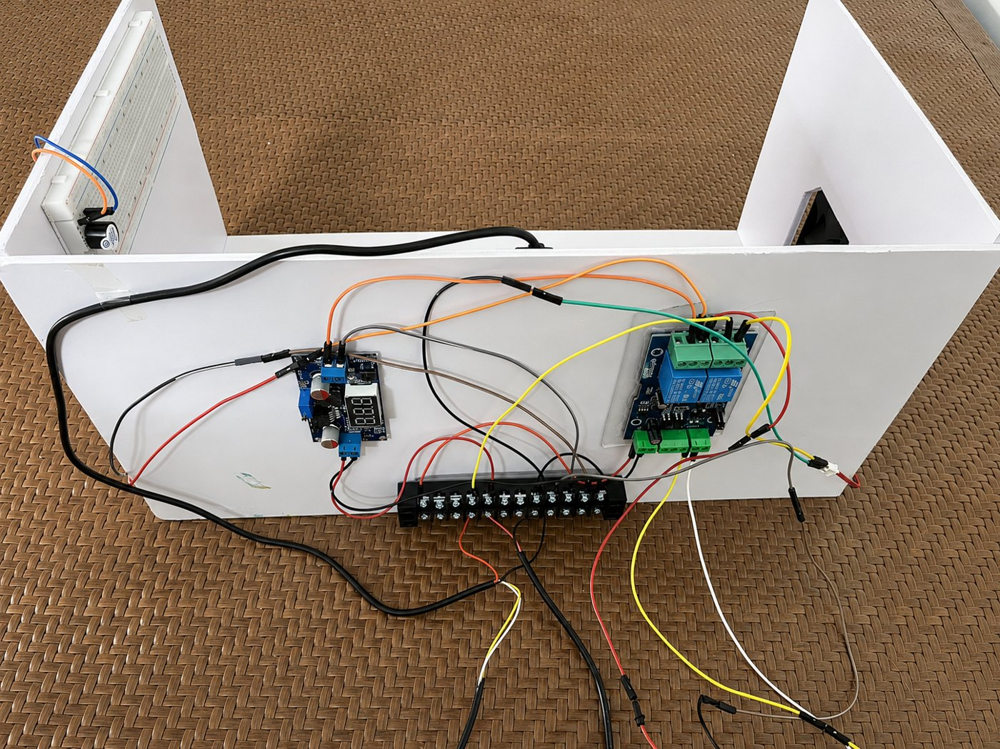<br><em>Bảng mạch &amp; linh kiện bên trong tủ</em></td>
  <td align="center">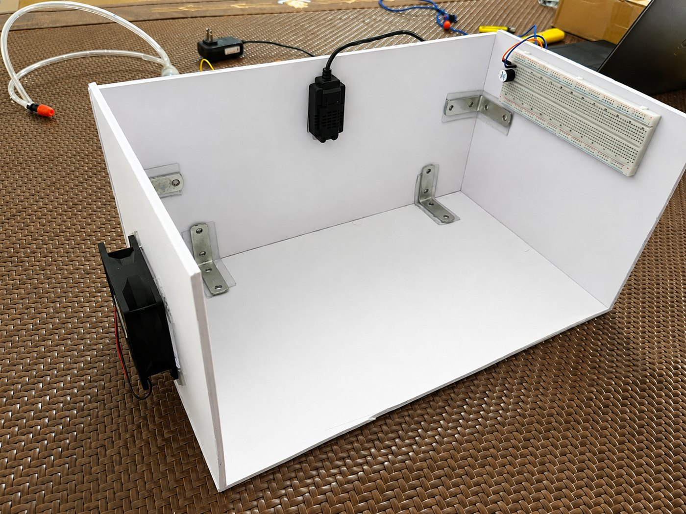<br><em>Hộp điện tử DIY — linh kiện nội thất</em></td>
  <td align="center">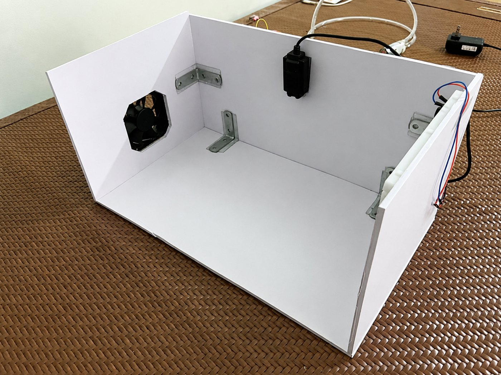<br><em>Tủ DIY trắng với quạt và dây điện</em></td>
</tr>
</table>

### Linh kiện

<p align="center">
  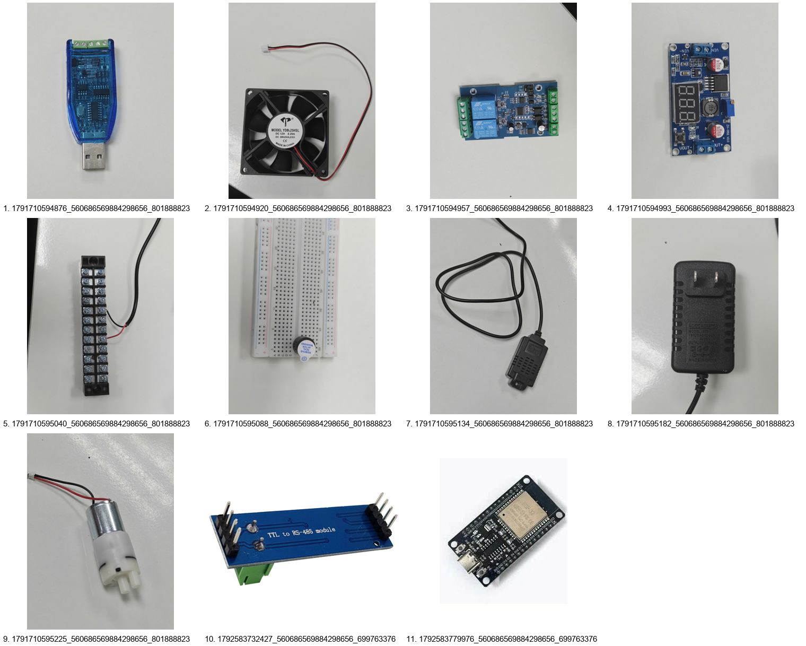
</p>

---

## 📡 Giao thức truyền thông

| Tầng | Kênh | Giao thức | Chi tiết |
|---|---|---|---|
| 1 | ESP32 ↔ thiết bị | **Modbus RTU** | 9600 · 8N1 · nghỉ ≥ 40 ms giữa 2 khung · timeout 0,4 s · CRC16 tự tính |
| 2 | ESP32 ↔ HMI | **JSON-lines / USB-C** | 115200 baud · mỗi dòng một JSON · `telemetry`/`ack`/`event` ↓ · `cmd`/`settings`/`ping` ↑ |
| 3 | HMI ↔ Cloud | **Firebase REST API** | `/system_status` · `/history` · `/control` · `/control_ack` · `/settings_ack` · `/alarms` |
| 3 | ERP ↔ Cloud | **Firebase JS SDK** | Listener realtime `child_added / child_changed / child_removed` → chỉ tải phần thay đổi |

**Cấu trúc dữ liệu trên cloud**

| Node | Nội dung | Ai ghi? |
|---|---|---|
| `/system_status` | Trạng thái mới nhất (nhiệt độ, độ ẩm, tải, mode, E-STOP, heartbeat) | HMI (1–2 s khi có ERP) |
| `/history/{key}` | Lịch sử, key là số 16 chữ số thuần để prune hoạt động | HMI |
| `/alarms/{key}` | Cảnh báo | HMI |
| `/control` | Lệnh ERP — **1 slot duy nhất**, chỉ mang ý định | ERP |
| `/control_ack`, `/control_acks/{seq}` | Xác nhận của board (kèm `accepted`, `result`, `message`) | HMI |
| `/settings` | Ngưỡng ERP **yêu cầu** | ERP |
| `/settings_ack` | Ngưỡng **board đã áp dụng** (`source: ESP32`) | HMI |
| `/erp_online` | Nhịp tim ERP — HMI dùng để chọn nhịp ghi/đọc | ERP |

---

## 🖥 Giao diện người dùng

<table>
<tr>
  <td align="center" width="50%"><br><em><b>Web ERP</b> — System Overview: KPI, bảng điều khiển, E-STOP, mô hình 3D Digital Twin và biểu đồ môi trường</em></td>
  <td align="center">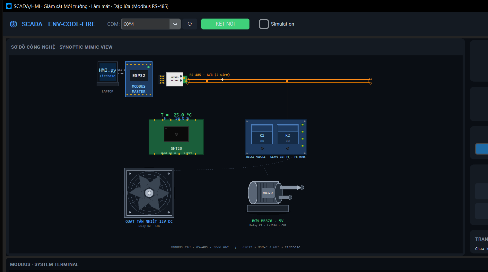<br><em><b>SCADA/HMI desktop</b> — sơ đồ công nghệ động: ESP32, bus RS-485, cảm biến, relay, quạt, bơm</em></td>
</tr>
<tr>
  <td align="center">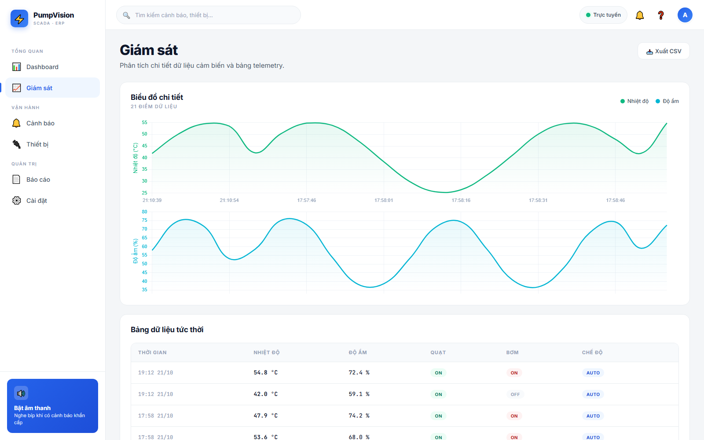<br><em><b>Web ERP</b> — biểu đồ môi trường theo thời gian</em></td>
  <td align="center">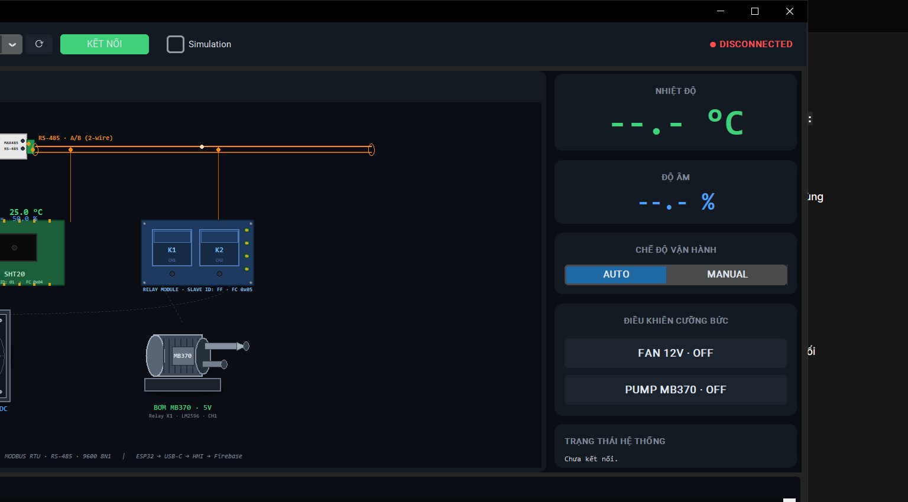<br><em><b>SCADA/HMI desktop</b> — panel nhiệt độ/độ ẩm, chế độ AUTO·MANUAL, điều khiển cưỡng bức</em></td>
</tr>
</table>

<p align="center">
  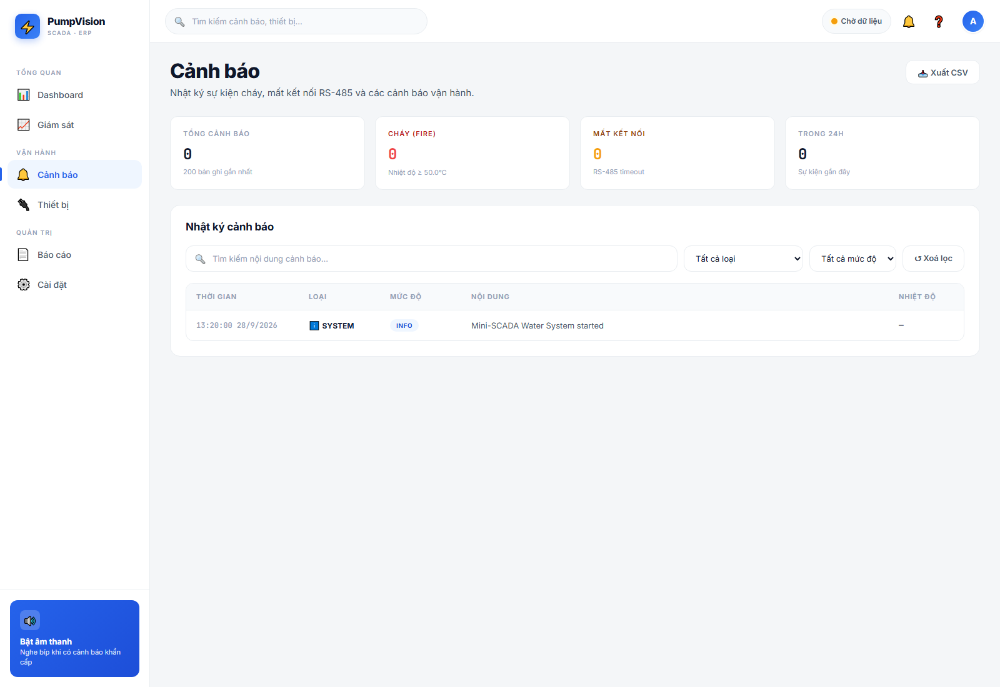
  <br><em>Danh sách cảnh báo với bộ lọc theo loại / mức độ và đếm chưa đọc</em>
</p>

---

## 🧠 Logic điều khiển & an toàn

| Lớp bảo vệ | Cơ chế |
|---|---|
| **Hysteresis** | Quạt bật ở ≥ 32 °C, tắt ở ≤ 30 °C · bơm bật ở ≥ 50 °C, tắt ở ≤ 42 °C — chống bật/tắt chập chờn |
| **Failsafe** | Mất cảm biến → **ngắt bơm ngay** (giữ quạt làm mát theo đặc tả) · gỡ sau 2 lần đọc OK liên tiếp · bơm không tự bật lại trong MANUAL (cảnh báo `MANUAL_CMD_LOST`) |
| **E-STOP** | Khóa cả hai tải · khôi phục từ cloud **được đẩy xuống board** · chỉ mở khi board xác nhận · nút E-STOP không bao giờ bị khóa |
| **Chống chạy lệnh** | Seq riêng cho lệnh ERP · 1 bộ đếm duy nhất gửi ESP32 (lưu flash + seed từ telemetry) · E-STOP miễn kiểm tra tuổi nhưng vẫn chặn theo seq |
| **Interlock** | `pump_cmd = true` bị chặn khi failsafe / thiếu tín hiệu · `clear_emergency` chỉ chạy khi tải đã OFF |
| **Lệnh rác** | Sai kiểu bool → **REJECT** kèm lý do · frame thiếu `issued_at_ms` → không fresh (giữ guard) |
| **ACK trung thực** | `/settings_ack` phản ánh **giá trị board đã xác nhận** (`source: ESP32`), không phải giá trị ERP yêu cầu |

---

## ✅ Kiểm chứng

**240/240 test hồi quy PASS** (`python -m unittest discover -s tests`) — chạy được ngay trên máy, không cần board thật.

| Nhóm test | Phạm vi |
|---|---|
| `test_pump_core.py` | Lõi logic: hysteresis, failsafe, E-STOP, chống replay, validate ngưỡng |
| `test_modbus_rtu.py` | Dựng khung Modbus, CRC16, frame đọc/ghi |
| `test_hmi_batch1.py` | Cầu nối HMI: tuổi lệnh, seq, ACK, khôi phục khóa E-STOP, cách ly file trạng thái thật |
| `test_main_fw.py` | Firmware `esp32/main.py` nạp với module máy giả — kiểm tra ghi coil và ghi flash |
| `test_bridge_integration.py` | Tích hợp HMI ↔ board: vòng lặp, ACK, giới hạn số lần ghi |
| `test_v16_bugs.py` | 7 lỗi an toàn đã sửa (E-STOP không đẩy được xuống board, `/settings_ack` không lên cloud, restore chỉ thử 1 lần…) |
| `test_v17_quota.py` | Chế độ free tier: toán hạn mức 20.000 ghi / 50.000 đọc mỗi ngày |
| `test_v17_docs.py` | Tài liệu nạp firmware khớp firmware — chặn hướng dẫn ghi file `.py` vào offset flash thô (làm hỏng board) |

| Chức năng | Điều kiện thử | Kết quả thực tế |
|---|---|---|
| Đọc nhiệt độ – độ ẩm | Cảm biến thật trên mô hình | ✅ Hiển thị đồng thời trên HMI, Web ERP và mô hình 3D, cập nhật 1 Hz |
| Bật/tắt quạt theo ngưỡng | Đặt 32/30 °C, tăng nhiệt độ | ✅ Hysteresis chống dao động, ghi nhận trên biểu đồ lịch sử |
| Bật bơm khi ≥ 50 °C | Đặt 50/42 °C | ✅ Bơm MB370 + còi báo chạy, cảnh báo `FIRE` sinh ra |
| Failsafe khi mất cảm biến | Rút dây cảm biến | ✅ Ngắt bơm trong 1 chu kỳ, quạt vẫn chạy, gỡ sau 2 lần đọc OK |
| E-STOP khóa cả 2 tải | Bấm trên HMI và trên ERP | ✅ Tải dừng ngay, ERP hiện LOCKED, lệnh gỡ bị chặn tới khi board xác nhận |
| Lệnh E-STOP cũ vẫn hiệu lực | HMI khởi động lại khi còn lệnh trên cloud | ✅ Board vẫn khóa, ERP nhận ACK đúng |
| Mô hình 3D Digital Twin | ERP đang mở, có telemetry | ✅ Badge `3D: OK (webgl2)`, trạng thái đổi theo telemetry |
| Chạy trong hạn mức free tier | ERP mở / ERP đóng | ✅ ~3.500 ghi + ~19.000 đọc mỗi ngày khi chạy 24/7 |

---

## 🚀 Chạy thử nhanh

> Chi tiết từng bước (flash firmware, tạo Firebase project, cấu hình Rules…) xem **[📘 Hướng dẫn kỹ thuật](docs/HDSD.md)**.

### 1. Flash firmware lên ESP32

> ⚠️ **Cảnh báo — làm đúng theo các bước dưới, nếu không có thể hỏng board.**
> Firmware gồm **3 file Python** (`main.py`, `pump_core.py`, `modbus_rtu.py`) và **phải được copy vào filesystem của board** (Thonny hoặc mpremote).
> **KHÔNG** ghi thẳng file `.py` vào offset flash bằng `esptool.py write_flash 0x…` — làm vậy file không nằm trong filesystem MicroPython (`import pump_core` sẽ lỗi) và còn đè vùng phân vùng flash khiến **board không còn boot được**.

```text
1. Nạp firmware MicroPython cho ESP32 (một lần):
   https://micropython.org/download/ESP32_GENERIC/
   · Thonny → Tools → Install MicroPython → ESP32 (Generic)
   · hoặc esptool.py: erase_flash rồi write_flash firmware.bin (file .bin, không phải .py)
2. Copy 3 file vào board (Thonny: mở file → Save as → chọn ổ ESP32; hoặc dùng mpremote):
   esp32/main.py · esp32/pump_core.py · esp32/modbus_rtu.py
3. Cấp điện lại — main.py tự chạy ngay
```

> 🔌 **Cổng nạp là USB-C (UART0)** — đúng cổng đang nối laptop để chạy HMI.
> `UART2` là bus RS-485 ra hiện trường, **không dùng để nạp**.
> Nếu app đã chạy thì REPL trên UART0 đã bị tắt (`os.dupterm(None)`) → giữ nút **BOOT** khi cấp điện để vào ROM loader.
> Chi tiết: [`esp32/README.md`](esp32/README.md)

### 2. Chạy HMI trên laptop

```bash
pip install pyserial requests customtkinter
python HMI.py          # chọn cổng COM → bấm "KẾT NỐI"
```

### 3. Mở Web ERP

> 💡 **Không cài đặt gì cả?** Mở demo đang chạy thật: <https://venhladamz-star.github.io/-ktm/>

```bash
python -m http.server 8000
# mở http://127.0.0.1:8000/index.html
```

> ⚠️ **Phải mở qua HTTP, không mở bằng `file://`** — bundle 3D (1,1 MB) và WebGL cần server.
> Trên GitHub Pages thì chạy thẳng vì đã là HTTPS.

---

## 📁 Cấu trúc thư mục

```text
dktm/
├── esp32/                       # 🔌 Firmware MicroPython cho ESP32 (bộ não điều khiển)
│   ├── main.py                  # Vòng lặp chính: UART RS-485 + UART USB + lưu flash
│   ├── modbus_rtu.py            # Modbus RTU master thuần (CRC16, FC04/FC05)
│   ├── pump_core.py             # Lõi logic: hysteresis · failsafe · E-STOP · chống replay
│   └── README.md                # Hướng dẫn flash + hợp đồng serial JSON
├── tests/                       # ✅ 240 test hồi quy (unittest, chạy được ngay trên máy)
├── assets/                      # 🧊 Bundle 3D Digital Twin (server-room-twin.umd.js + css)
├── docs/                        # 📘 Tài liệu chi tiết + ảnh minh hoạ
│   ├── HDSD.md                  # Hướng dẫn kỹ thuật & triển khai
│   └── img/                     # Ảnh chụp thực tế (ERP, HMI, mô hình, linh kiện)
├── HMI.py                       # 🖥 SCADA/HMI desktop — cầu nối serial ↔ Firebase
├── index.html                   # 🌐 PumpVision Web ERP — không build, không framework
├── hmi_state.json               # Trạng thái HMI lưu qua restart (mode / ngưỡng / seq)
└── README.md
```

---

## 🧰 Công nghệ

| Tầng | Công nghệ |
|---|---|
| Vi điều khiển | ESP32-D0WD-V3 · MicroPython · UART2 (RS-485) + UART0 (USB-C) |
| Truyền thông công nghiệp | Modbus RTU — 9600 · 8N1 · lớp `modbus_rtu.py` thuần, không cần thư viện ngoài |
| Ứng dụng desktop | Python · CustomTkinter · pyserial · requests (1 file duy nhất `HMI.py`) |
| Cloud | Firebase Realtime Database — REST API (HMI) + JavaScript SDK (web) |
| Web | HTML · CSS · JavaScript thuần · Chart.js · bundle UMD React + three.js (Digital Twin) |
| Kiểm thử | `unittest` — 240 test, không phụ thuộc thiết bị thật |

---

## 🔒 Bảo mật & giới hạn

Vui lòng đọc trước khi công khai repo:

- ⚠️ **Mật khẩu demo `0001` nằm trong `HMI.py`** và API key Firebase (Web API key vốn không phải secret, nhưng **mật khẩu demo thì có**). Đổi mật khẩu hoặc để repo private.
- ⚠️ **Firebase Rules đang mở** (`".read": true, ".write": true`) vì web không đăng nhập. Ai có URL cũng gửi được lệnh tới `/control` (bật bơm, E-STOP). Muốn siết lại: bật `"auth != null"` + Anonymous Auth, hoặc thêm kiểm tra ở backend.
- ⚠️ Hệ thống **điều khiển cơ cấu vật lý thật** — kiểm tra lại đường dây, tải và nguồn trước khi cấp điện lần đầu.
- ℹ️ **Hạn mức Firebase free tier**: 20.000 ghi + 50.000 đọc/ngày. HMI đã có chế độ tự chọn nhịp nên chạy 24/7 vẫn an toàn; nếu cần chạy dày hơn hoặc nhiều thiết bị thì bật **Blaze (pay-as-you-go)**.
- ℹ️ **Giới hạn thiết kế**: chưa có module phản hồi tiếp điểm relay ⇒ hệ thống biết trạng thái *lệnh* nhưng không biết tải thật đã đóng hay chưa.

---

## 📄 Tài liệu

| Tài liệu | Nội dung |
|---|---|
| **[📘 Hướng dẫn kỹ thuật & triển khai](docs/HDSD.md)** | Cài Firebase, flash ESP32, cấu hình, bảng hằng số, bảo mật, xử lý sự cố |
| **Báo cáo đồ án** | [`PumpVision_Bao_cao_Final.docx`](PumpVision_Bao_cao_Final.docx) — theo mẫu trường, kèm ảnh mô hình & linh kiện thật |
| **Tài liệu nguồn** | [`PumpVision_Tai_lieu_chuan.docx`](PumpVision_Tai_lieu_chuan.docx) — đối chiếu từng cơ chế với mã nguồn + bảng "lỗi đã sửa" |

## 📄 Giấy phép & lưu ý

Đồ án học phần môn **Điều khiển thông minh** — dùng cho mục đích học tập và trình bày. Trước khi công khai hoặc triển khai thực tế, hãy thay đổi mật khẩu demo, siết lại Firebase Rules và kiểm tra lại toàn bộ đường điện.

---

<p align="center"><b>PumpVision · ENV-COOL-FIRE</b><br>
ESP32 · Modbus RTU · SCADA/HMI · Firebase RTDB · Web ERP + Digital Twin 3D</p>
