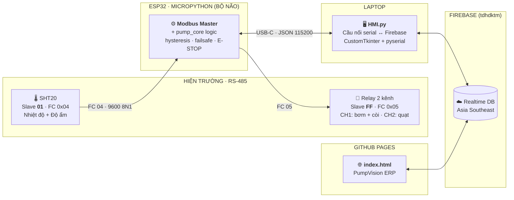

<div align="center">

# Hướng dẫn kỹ thuật & triển khai chi tiết — PumpVision

**SCADA/HMI + Web ERP — Giám sát môi trường, làm mát & dập lửa khẩn cấp**

**ESP32 (MicroPython) · Modbus RTU RS-485 · USB-C Serial · Firebase Realtime Database · CustomTkinter · Vanilla JS**

[](../HMI.py)


[](../HMI.py)
[](https://venhladamz-star.github.io/-ktm/)

</div>

---

## 🎯 Tổng quan

Hệ thống gồm **bộ điều khiển nhúng ESP32** + **hai ứng dụng** giao tiếp với nhau **duy nhất qua Firebase Realtime Database**
— không cần server trung gian, không cần `firebase-admin`:

| | Thành phần | Vai trò |
|---|---|---|
| ⚙️ | **`esp32/`** — firmware MicroPython (ESP32-D0WD-V3) | **Modbus Master + toàn bộ logic điều khiển.** Đọc SHT20, chạy hysteresis/failsafe/E-STOP, ghi relay. Mất laptop vẫn tự chạy an toàn. |
| 🖥 | **`HMI.py`** — SCADA/HMI desktop | **Cầu nối serial ↔ Firebase + hiển thị.** Nói chuyện với ESP32 qua USB-C (JSON 115200), đẩy trạng thái lên cloud, chuyển tiếp lệnh từ ERP xuống ESP32. |
| 🌐 | **`index.html`** — PumpVision Web ERP | **Source of truth về lệnh.** Chạy trên GitHub Pages: giám sát, cấu hình ngưỡng, gửi lệnh điều khiển từ xa, xem lịch sử & cảnh báo, **mô hình 3D Digital Twin** phòng server. |

> Triết lý thiết kế: **ESP32 quyết định trạng thái, ERP quyết định ý định, HMI là cầu nối.**
> Mọi lệnh đều đi `/control` → HMI kiểm tra hợp lệ → chuyển tiếp xuống ESP32 qua serial → ESP32 thực thi → trả `/control_ack`.
> **ESP32 là bộ não**: mọi logic an toàn đều nằm trên board, không phụ thuộc laptop.

---

## 🏗 Kiến trúc



**Dòng dữ liệu chính:**

1. `esp32/` đọc SHT20 (1 s/lần) → gửi telemetry qua USB-C → `HMI.py` nhận và đẩy `/system_status` (1 s/lần) + `/history` (5 s/lần) · prune `/history` + `/alarms` bản >3 ngày mỗi 10 phút
2. ERP lắng nghe → render dashboard, biểu đồ, bảng lịch sử
3. Người vận hành bấm lệnh trên ERP → ghi `/control` kèm `command_sequence`
4. `HMI.py` poll `/control` (0,3 s) → kiểm tra hạn dùng & thứ tự → **chuyển tiếp lệnh xuống ESP32 qua serial** → ESP32 thực thi → trả ack → ghi `/control_ack`
5. ERP khớp `ack === seq` → báo **Đã xác nhận** (timeout 12 s)

---

## 🔌 Phần cứng & Modbus RTU

**Linh kiện thực tế (bộ thiết bị):**

| # | Linh kiện | Vai trò |
|---|---|---|
| 1 | **ESP32-D0WD-V3** (MicroPython) | Modbus master + toàn bộ logic điều khiển |
| 2 | **Mô đun chuyển đổi TTL → RS-485 (MAX485 / SP3485)** | Nối UART2 của ESP32 với bus RS-485 (2 dây A/B) — **bắt buộc**: ESP32 không có RS-485 sẵn |
| 3 | **Cảm biến SHT20** | Nhiệt độ + độ ẩm, Modbus slave **1** |
| 4 | **Bảng relay 2 kênh** (Modbus slave **255**) | CH1: máy bơm MB370 + còi báo · CH2: quạt 12 V |
| 5 | **Máy bơm MB370 + còi báo** | Tải CH1 (khủng hoảng) |
| 6 | **Quạt 12 V** | Tải CH2 (làm mát) |
| 7 | **Laptop** (chạy `HMI.py` + mở Web ERP) | Cầu nối serial ↔ Firebase + giao diện |

**Phân chia trách nhiệm:**
- **ESP32 ↔ thiết bị (RS-485):** `9600 · 8N1` · nghỉ giữa 2 frame ≥ **40 ms** · timeout 0,4 s — chạy hoàn toàn trên board.
  *Đường tín hiệu:* `ESP32 UART2 (TX/RX/DE)` → **mô đun TTL→RS-485** → bus 2 dây A/B → SHT20 (slave 1) + bảng relay (slave 255).
- **Laptop ↔ ESP32 (USB-C):** `115200` baud, mỗi dòng một JSON (`telemetry`/`ack`/`event` ← ESP32; `cmd`/`settings`/`ping` → ESP32).

### Cảm biến SHT20

| Tham số | Giá trị |
|---|---|
| Slave ID | **1** |
| Hàm chức năng | **0x04** — Input Register |
| Nhiệt độ | thanh ghi **1** (`0x0001`) — đối chiếu kiểu 3xxxx: **30002** |
| Độ ẩm | thanh ghi **2** (`0x0002`) — đối chiếu kiểu 3xxxx: **30003** |
| Kiểu dữ liệu | 16-bit **có dấu**, giá trị thật = `raw / 10` |

> Đọc lệch 1 thanh ghi? Đổi hằng `SHT20_REG_START` giữa `0x0001` ↔ `0x0000`.

### Bảng relay 2 kênh

| Kênh | Coil | Tải | Ghi ON |
|---|---|---|---|
| **CH1** | `0x0000` | **Máy bơm MB370 + Còi báo** (mắc song song) | `0xFF00` |
| **CH2** | `0x0001` | **Quạt tản nhiệt 12V** | `0xFF00` |

| Tham số | Giá trị |
|---|---|
| Slave ID | **255** (`0xFF`) — *Địa chỉ chuẩn Modbus là 1–247; 255 là địa chỉ dành riêng (reserved), board relay của nhóm chỉ nhận khi để 255 — lớp `modbus_rtu.py` vẫn gửi và chờ khung echo xác nhận* |
| Hàm chức năng | **0x05** — Write Single Coil |

> Board của bạn đánh coil bắt đầu từ **1**? Sửa hằng coil trong `esp32/main.py` (`pc.CH_PUMP` / `pc.CH_FAN`).

---

## 🧠 Logic điều khiển

### Hysteresis (không bật/tắt chập chờn)

| Cơ cấu | BẬT khi | TẮT khi | Mặc định |
|---|---|---|---|
| 🌀 Quạt | `T ≥ FAN_ON` | `T ≤ FAN_OFF` | **32.0 / 30.0 °C** |
| 🚒 Bơm + còi | `T ≥ PUMP_ON` | `T ≤ PUMP_OFF` | **50.0 / 42.0 °C** |

Ngưỡng được **chỉnh sống từ ERP** (tab *Cài đặt*), có ràng buộc:

- `OFF < ON` từng cặp
- **Quạt phải làm mát TRƯỚC** khi bơm phun nước: `FAN_ON ≤ PUMP_ON` và `FAN_OFF ≤ PUMP_OFF`
- HMI từ chối cấu hình sai → ghi đè lại `/settings` bằng bộ ngưỡng **đang chạy** → ERP tự khôi phục input
- Ngưỡng được lưu kèm vào `hmi_state.json` khi thay đổi và nạp lại khi khởi động → boot lúc mất mạng vẫn chạy đúng ngưỡng (không rơi về default 32/30/50/42)

### An toàn

| Tính năng | Hành vi |
|---|---|
| **Failsafe** | **ESP32** mất dữ liệu cảm biến **1 chu kỳ** → cưỡng bức ngắt bơm ngay, báo `COMM_LOSS` **đúng 1 lần** (không spam) — chạy trên board, không cần laptop |
| **E-STOP** | Khi khóa: cả 2 tải OFF và **không ghi Modbus thừa** ở chu kỳ sau; chỉ ghi khi tải còn đang ON |
| **Mất cổng COM (laptop)** | USB-C bị tuột → HMI nhận diện, thử mở lại mỗi **3 s**, nhãn chuyển `● LINK LOST`. **ESP32 vẫn chạy nền**, không mất chức năng bảo vệ |
| **Mất RS-485 (ESP32)** | ESP32 mất bus → failsafe ngắt bơm, tự thử lại mỗi chu kỳ poll |
| **Quy tắc ngưỡng** | `max_timeouts` bị khóa ở **1** — không cho nới lỏng failsafe từ cloud |
| **Chống replay** | Lệnh cũ hơn 30 s, **thiếu/hỏng `issued_at_ms`**, hoặc có `issued_at_ms` trước khi HMI khởi động → `REJECTED`. Áp cho **cả E-STOP** (frame E-STOP cũ bị từ chối, `last_seq` không bao giờ lùi) |
| **Chống lệch giờ** | Máy HMI và trình duyệt cho phép lệch tới **30 s** (NTP) |
| **⚠️ E-STOP là phần mềm** | Nút ⛔ gửi lệnh qua cloud → HMI chuyển tiếp xuống ESP32. **Muốn an toàn thật** phải có nút nhấn vật lý (NC) trên mạch điện, không dựa vào phần mềm. ESP32 lưu `emergency_lock` sang flash nên **tắt/restart board vẫn giữ khóa** |

### Chế độ vận hành

- **AUTO** — ESP32 tự quyết định theo hysteresis (chạy trên board, không cần laptop)
- **MANUAL** — người vận hành bật/tắt từng cơ cấu (qua nút trên HMI hoặc ERP, đều đi qua ESP32)
- Khi đang **Polling**, HMI chặn đổi sang **Simulation** — dùng ESP32 ảo chạy **cùng lõi `pump_core`** trên máy (không cần phần cứng)

---

## 💻 HMI máy tính để bàn

**`HMI.py`** — một file duy nhất, không cần server.

```bash
pip install customtkinter pyserial requests
python HMI.py
```

- Ô **COM** tự quét lại mỗi **3 giây** cho tới khi thấy cổng serial của ESP32
- Nếu thiếu thư viện, app **báo đúng nguyên nhân** thay vì để dropdown trống im lặng
- Sơ đồ hiện trường vẽ trực tiếp trên `Canvas`: ESP32 · SHT20 · Relay · Quạt · Bơm — LED theo trạng thái mirror từ telemetry
- Ô log có phân loại màu (`SER` / `ESP32` / `FB` / `ERR` / `OK`), tự cắt ở 500 dòng
- Chế độ **Simulation** cho phép chạy demo không cần phần cứng (ESP32 ảo chạy `pump_core`)

---

## 🌐 Web ERP

**`index.html`** — một file HTML, chạy nguyên bản trên GitHub Pages (không build, không framework).

**Mở trực tiếp: <https://venhladamz-star.github.io/-ktm/>**

| Tab | Nội dung |
|---|---|
| **System Overview** | KPI nhiệt độ/độ ẩm, công tắc AUTO·MANUAL, nút quạt/bơm, **⛔ E-STOP**, **mô hình 3D Digital Twin** (2 sub-tab: *Digital Twin* + *Environmental Monitoring Over Time*) |
| **Giám sát** | Biểu đồ nhiệt độ – độ ẩm theo thời gian thực |
| **Cảnh báo** | Danh sách alarm, lọc theo loại/mức độ/tìm kiếm, đếm chưa đọc |
| **Thiết bị** | Thông số từng thiết bị Modbus, ngưỡng đang chạy, trạng thái kênh relay |
| **Báo cáo** | Bảng lịch sử chi tiết, xuất CSV |
| **Cài đặt** | Sửa ngưỡng hysteresis rồi đồng bộ về HMI |

**Điểm nhấn kỹ thuật:**

- 🔐 Web **không cần đăng nhập** — mở link là vào; HMI (desktop) vẫn đăng nhập Email/Password vì REST API cần token
- 🔁 Lắng nghe lịch sử bằng `child_added / child_changed / child_removed` thay vì
  `value + limitToLast(300)` → mỗi chu kỳ chỉ tải **~400 B**, không tải lại 90 KB mỗi 5 giây
- ⏱ **Cảnh báo ACK sau 12 s** nếu HMI không phản hồi, kèm gợi ý chẩn đoán
- 🛡 Mọi dữ liệu từ cloud đều qua `escapeHTML()` / `num()` trước khi nhúng vào DOM (chống XSS)
- 📱 Responsive, có menu trượt trên mobile
- 🧊 **Mô hình 3D Digital Twin** (port nguyên khối từ dự án môn *Kiến trúc mạng*): bundle UMD tự chứa React + three.js trong `assets/server-room-twin.umd.js`, dựng trong tab *Digital Twin*; badge `3D: OK (webgl2)` báo trạng thái WebGL; nhiệt/ẩm/quạt/bơm đẩy qua `queueTwinUpdate()` (debounce 400 ms)
- 📂 **Phải mở ERP qua HTTP, không mở bằng `file://`** — bundle 3D (1,1 MB) + WebGL cần server: `python -m http.server 8000` rồi vào `http://127.0.0.1:8000/index.html` (trên GitHub Pages thì OK vì đã là HTTPS)
- 🧩 Bảng **Cảnh báo** render lại toàn bộ (~200 phần tử) mỗi khi có alarm đổi — perf NIT, chấp nhận được ở quy mô này, chưa tối ưu (đợt 4 xác nhận bỏ qua)

---

## ☁️ Hợp đồng Firebase

Cả hai ứng dụng **chỉ** giao tiếp qua các node sau — đổi tên node là hỏng liên thông.

| Node | HMI | ERP | Cấu trúc trường |
|---|---|---|---|
| `/system_status` | ghi 1 s | `on('value')` | `temperature, humidity, fan_state, pump_state, mode, comm_ok, failsafe, emergency_lock, heartbeat, last_command_sequence, last_command_result, timestamp` |
| `/history/{ms}` | ghi 5 s | `child_added/changed/removed` | giống `system_status`, key = mili-giây; prune bản >3 ngày (10 phút/lượt) |
| `/alarms/{id}` | `push` | `value · limitToLast(200); prune bản >3 ngày` | `type, message, temperature, timestamp, alarm_id` — `alarm_id = {epoch_ms}_{n}_{type}` (bắt đầu bằng epoch-ms để `prune` theo `$key` hoạt động) |
| `/control` | **đọc** 0,3 s | **`transaction()`** | `command_sequence, mode_cmd, fan_cmd, pump_cmd, emergency_cmd, clear_emergency, issued_at, issued_at_ms, issued_by, client_id` — **chỉ gửi trường có ý định** (đổi chế độ không kèm lệnh tải; lệnh web đầu tiên không tắt nhầm quạt/bơm đang chạy) |
| `/control_ack` | **ghi** | `value` + khớp `seq` + `client_id` | `command_sequence, accepted, result, message, mode, fan_state, pump_state, emergency_lock, timestamp, client_id` |
| `/control_acks/{seq}` | **ghi** (song song với `/control_ack`) | `watchAck` theo seq đang chờ | giống `/control_ack` — mỗi seq 1 key riêng, client khác gửi lệnh không ghi đè mất ACK |
| `/settings` | đọc 3 s | `set()` + `value` | `fan_on, fan_off, pump_on, pump_off, max_timeouts` |

**Mã cảnh báo:** `FIRE` · `COMM_LOSS` · `EMERGENCY` · `FAN_ACTUATOR_FAIL` · `PUMP_ACTUATOR_FAIL` · `ESTOP_RELAY_FAIL`

**Kết quả lệnh:** `PENDING` · `ACCEPTED` · `REJECTED`

> ⚠️ **`/control` là 1 slot, không phải hàng đợi**: `transaction()` chỉ chặn ghi đè khi còn
> lệnh chờ ACK (< 30 s) — gửi liên tiếp thì lệnh đến sau phải chờ lệnh trước được ACK
> hoặc hết hạn. Cần lệnh mới ngay: chờ ACK rồi gửi tiếp.

---

## 🚀 Cài đặt & Triển khai

### 1. Firebase (một lần duy nhất)

```text
Console → Authentication → Sign-in method → Bật "Email/Password"   ← cho HMI (desktop)
Console → Realtime Database → chọn vùng, rồi đặt Rules:
```

Dự án hiện tại: **`tdhdktm`** (Asia Southeast) — xem `HMI.py` (đầu file) và `index.html` (`FIREBASE_CONFIG`).

```json
{
  "rules": {
    ".read":  true,
    ".write": true
  }
}
```

> ℹ️ **Rules PHẢI mở** vì web không đăng nhập. Hệ quả: *bất kỳ ai* có URL đều ghi được
> `/control` và **điều khiển được máy bơm + còi từ xa**. Đây là đánh đổi đã chọn để
> không cần tài khoản (project lớp học). Muốn chặn lại: bật `"auth != null"` trở lại
> **và** cho web đăng nhập (Anonymous Auth là cách nhẹ nhất — không cần email/mật khẩu).
>
> ⚠️ **Rules là cấu hình trên Firebase Console, code không tự đặt được** — trước khi
> vận hành thật, hãy tự mở Console kiểm tra lại Rules (dự án này để `.read/.write: true`).
>
> 🔑 **Mật khẩu `PW_CODE` trong `index.html` CHỈ là trở ngại giao diện** — nó nằm trong
> file JS gửi cho trình duyệt, ai cũng đọc được từ Console, và ai đó có URL + rules mở
> thì `POST` thẳng vào REST API là gửi lệnh được (bật bơm, E-STOP) mà không qua UI.
> **Phân quyền thật phải nằm ở Firebase Rules / backend** — xem mục 🔒 Bảo mật.
>
> Đồng hồ hai máy cần lệch **< 30 s** (NTP) để lệnh không bị từ chối oan.

> ✅ **Chế độ FREE TIER — KHÔNG cần bật Blaze.**
> Hạn mức Firebase Spark: **20.000 ghi + 50.000 đọc mỗi ngày**. Nhịp cũ (đẩy
> `/system_status` 2 s + poll `/control` 1 s) ⇒ 60.480 ghi + 115.200 đọc/ngày ⇒
> vượt hạn mức sau ~7,9 h ⇒ Firebase throttle ⇒ **ERP mất đường điều khiển**
> (E-STOP cũng không ghi được vào `/control`).
>
> Nay HMI **tự chọn nhịp theo tình trạng ERP** (ERP ghi nhịp tim `/erp_online`
> mỗi 60 s ⇒ 1.440 ghi/ngày khi tab mở):
>
> | Chế độ | Khi nào | `/system_status` | `/history` | poll `/control` | poll `/settings` |
> |---|---|---|---|---|---|
> | **NHANH** (demo sống động) | có ERP đang mở | 2 s | 10 s | 1 s | 5 s |
> | **TIẾT KIỆM** (chạy 24/7) | không có ERP | 30 s | 2 phút | 10 s | 1 phút |
>
> → Chạy liên tục 24/7: ~3.500 ghi + ~19.000 đọc/ngày (**18% / 38% hạn mức**).
> → Mở ERP để demo: nhịp NHANH (lệnh tới board ≤ 1 s, KPI cập nhật mỗi 2 s).
> → Ngoài ra HMI tự đếm số ghi trong ngày; khi chạm 85% hạn mức (17.000) thì
> **ép về nhịp TIẾT KIỆM** để không bao giờ vượt 20.000.
> Chỉnh tay trong `HMI.py`: `Config.LIVE_*` (nhịp nhanh) và `Config.IDLE_*` (nhịp tiết kiệm).

### 2. Flash ESP32 (một lần)

```text
1. Flash firmware MicroPython cho ESP32 (esptool / Thonny)
2. Copy 3 file vào board: esp32/modbus_rtu.py, esp32/pump_core.py, esp32/main.py
3. Reset board — main.py tự chạy khi cấp điện
```

> Hướng dẫn chi tiết: [`esp32/README.md`](../esp32/README.md) · firmware **không dùng WiFi**, chỉ USB-C serial.

### 3. HMI (laptop)

```bash
pip install customtkinter pyserial requests
python HMI.py
```

Cắm **USB-C từ ESP32** → chọn cổng COM → **KẾT NỐI** (hoặc bật *Simulation* để demo — ESP32 ảo chạy `pump_core`).

### 3b. Đóng gói HMI thành file .exe (tự chọn)

```bash
pip install pyinstaller
pyinstaller --noconfirm --clean HMI.spec
```

Kết quả: `dist/HMI.exe` (~35 MB, bản one-file, đã bundle sẵn `customtkinter`).
Cả thư mục `build/` và `dist/` đã được thêm vào `.gitignore` — không commit lên repo.

> ⚠️ File .exe chứa **mật khẩu demo `0001`** và Firebase API key bên trong — để truyền cấp nhất bị để ý.

### 3. Web ERP

Mở <https://venhladamz-star.github.io/-ktm/> là vào — **không cần đăng nhập**.
Muốn tự host: bật **GitHub Pages → Deploy from branch → main / root**, file `index.html`
chính là trang chủ.

---

## ⚙️ Bảng cấu hình

### HMI (`class Config` trong `HMI.py`)

| Hằng | Mặc định | Ý nghĩa |
|---|---|---|
| `LINK_BAUD` | `115200` | Cầu serial USB-C laptop ↔ ESP32 (JSON-lines) |
| `FAN_ON / FAN_OFF` | `32.0 / 30.0` | Ngưỡng hysteresis quạt (°C) — validate tại HMI rồi đẩy xuống ESP32 |
| `PUMP_ON / PUMP_OFF` | `50.0 / 42.0` | Ngưỡng hysteresis bơm (°C) |
| `FB_PUSH_SEC / HISTORY_PUSH_SEC` | `5.0` | Chu kỳ đẩy `/history` (s); `/system_status` dùng `POLL_INTERVAL` = 1 s |
| `CONTROL_POLL_SEC` | `0.3` | Chu kỳ poll `/control` (s) |
| `SETTINGS_POLL_SEC` | `3.0` | Chu kỳ poll `/settings` (s) |
| `CONTROL_MAX_AGE_SEC` | `30.0` | Lệnh cũ hơn bị bỏ (chống replay — HMI kiểm tra trước khi chuyển tiếp) |
| `CLOCK_SKEW_TOL_MS` | `30000` | Dung sai lệch giờ HMI ↔ trình duyệt |
| `REOPEN_SEC` | `3.0` | Thử mở lại cổng serial sau khi mất |

### ESP32 (`esp32/main.py`)

| Hằng | Mặc định | Ý nghĩa |
|---|---|---|
| `LINK_BAUD` | `115200` | UART0 — USB-C sang laptop |
| `RS485_BAUD` | `9600` | Bus hiện trường 8N1 |
| `RS485_TX / RS485_RX / RS485_DE` | `17 / 16 / 4` | Chân UART2 + DE/RE bộ dịch RS-485 |
| `SLAVE_SHT20 / SLAVE_RELAY` | `1 / 255` | Địa chỉ slave |
| `SHT20_REG_START` | `0x0001` | Thanh ghi nhiệt độ (độ ẩm = +1) |
| `POLL_MS / TELEMETRY_MS` | `1000 / 1000` | Chu kỳ đọc cảm biến · gửi telemetry |
| `INTER_FRAME_MS` | `40` | Nghỉ giữa 2 frame Modbus |
| `MODBUS_TIMEOUT_MS` | `400` | Thời gian chờ response |
| `STATE_PATH` | `/pumpvision_state.json` | Lưu settings/mode/E-STOP sang flash |

### Lõi logic (`esp32/pump_core.py`) — **giống hệt** hành vi cũ

| Hằng | Mặc định | Ý nghĩa |
|---|---|---|
| `FAN_ON / FAN_OFF` | `32.0 / 30.0` | Hysteresis quạt |
| `PUMP_ON / PUMP_OFF` | `50.0 / 42.0` | Hysteresis bơm |
| `MAX_TIMEOUTS` | `1` | Chu kỳ mất dữ liệu trước khi failsafe — **bị khóa** |
| `CONTROL_MAX_AGE_MS` | `30000` | Chống replay trên ESP32 (lệnh cũ hơn 30 s bị bỏ) |
| `CONTROL_FUTURE_TOL_MS` | `300000` | Dung sai lệnh "hướng tương lai" |

---

> **Bản nộp**: dùng `PumpVision_Tai_lieu_chuan.docx` (đã cập nhật — tài liệu
> nguồn đối chiếu code + bảng "lỗi đã sửa"). File báo cáo IEEE cũ **đã xoá có chủ ý**
> (thuộc phiên bản trước) nên **không nộp kèm**. Nếu cần PDF, **xuất lại từ .docx**
> (Word → Lưu PDF) — các file PDF cũ đã xoá vì chúng thuộc phiên bản trước (dễ nộp nhầm).

## 🔒 Bảo mật — đọc trước khi up GitHub

Dự án này **điều khiển cơ cấu vật lý thật**, nên hãy soát lại trước khi đặt repo **public**:

- [ ] **`FIREBASE_API_KEY`, `FIREBASE_DB_URL`, tài khoản demo** đang hardcode trong
      `HMI.py` (web **đã bỏ đăng nhập**, không còn password ở `index.html`).
      API key của Firebase Web API vốn không phải secret, nhưng **password demo thì có**.
- [ ] ⚠️ Rules **phải là `".read": true, ".write": true`** vì web không đăng nhập —
      đọc thêm cảnh báo ở mục *Cài đặt & Triển khai → Firebase*. Muốn siết lại thì bật
      `"auth != null"` **và** cho web đăng nhập (Anonymous Auth).
- [ ] Nếu fork dự án: **thay `FIREBASE_DB_URL`** sang project của bạn, nếu không
      hai Instance sẽ ghi chung vào một database.
- [ ] Đặt lại `DEMO_EMAIL` / `DEMO_PASSWORD` trong `HMI.py` trước khi công khai.

---

## 📁 Cấu trúc dự án

```text
dktm/
├── esp32/                    # Firmware MicroPython cho ESP32 (bộ não điều khiển)
│   ├── main.py               # Vòng lặp chính: UART RS-485 + UART USB + lưu flash
│   ├── modbus_rtu.py         # Modbus RTU master thuần (CRC16, frame FC04/FC05)
│   ├── pump_core.py          # Lõi logic: hysteresis · failsafe · E-STOP · chống replay
│   └── README.md             # Hướng dẫn flash + hợp đồng serial JSON
├── HMI.py                    # SCADA/HMI desktop — cầu nối serial ↔ Firebase
├── index.html                # PumpVision Web ERP — chạy nguyên bản trên GitHub Pages
├── assets/                   # Bundle 3D Digital Twin (server-room-twin.umd.js + .css)
├── hmi_state.json            # Trạng thái HMI lưu qua restart (mode/ngưỡng/seq)
└── README.md
```

> **Lõi logic (`pump_core.py`) chạy trên cả CPython lẫn MicroPython** — cho phép
> test đầy đủ trên máy (`python -m unittest discover -s tests`) và chạy y hệt trên board.
> Bộ test hiện có **240/240 PASS** (`pump_core`, `modbus_rtu`, tích hợp HMI, và `esp32/main.py`
> nạp với module `machine` giả để kiểm tra ghi coil/flash mà không cần board thật).

> Dự án cố ý **không dùng thư viện build**: Python chạy được ngay, HTML mở được ngay.
> Ít phụ thuộc = ít thứ hỏng khi đổi máy.

---

## 🧰 Công nghệ

| Tầng | Thành phần |
|---|---|
| Ngôn ngữ | Python 3 (HMI) · MicroPython (ESP32) · JavaScript (ES5 tương thích cũ) |
| Giao diện desktop | [CustomTkinter](https://github.com/TomSchimansky/CustomTkinter) |
| Vi điều khiển | ESP32 (ESP32-D0WD-V3) — MicroPython, Modbus master |
| Giao thức công nghiệp | Modbus RTU — tầng RS-485 do ESP32 đảm nhận (lớp `modbus_rtu.py` thuần, không cần thư viện ngoài) |
| Liên kết laptop ↔ ESP32 | USB-C serial 115200 — JSON-lines ([pyserial](https://github.com/pyserial/pyserial)) |
| Giao diện web | HTML/CSS/JS thuần — không framework, không bundler |
| Cloud | Firebase Realtime Database (`tdhdktm`) · SDK compat `9.23.0` |
| API HTTP | `requests` (HMI dùng REST, **không cần** `firebase-admin`) |
| Hosting | GitHub Pages |

---

<div align="center">

**PumpVision** — *giám sát bằng dữ liệu, an toàn bằng logic.*

[](https://venhladamz-star.github.io/-ktm/)

</div>
